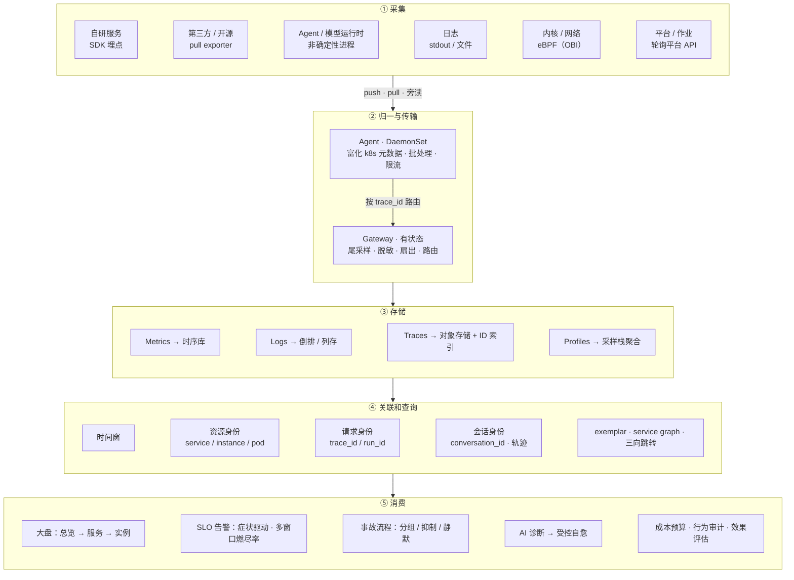

# 可观测洞察

## 1. 可观测技术通用实现

**一张图看全貌**：

### 1.1 关键模块与成熟度

| 段 | 模块 | 标准实现 | 成熟度 | 收敛度 |
| --- | --- | --- | --- | --- |
| **① 采集** | SDK 埋点 | OTel SDK| 高（traces / metrics 稳定 · logs 基本稳定 · profiles experimental） | 收敛 |
| | 语义约定 | OTel semconv | 分域定级（HTTP / DB / RPC / messaging stable · GenAI、CI/CD 仍 experimental / RC） | 分域：其余收敛 · GenAI / CI/CD 发散（新事物） |
| | 三方 exporter | `/metrics` 端点 + Prometheus 文本格式 | 高（事实标准，非 OTel） | 收敛 |
| | 旁读采集 | Fluent Bit / Vector | 高（事实标准强于官方标准） | 收敛 |
| | eBPF | OBI（原 Grafana Beyla） | 中（已并入 OTel） | 收敛 |
| | 平台轮询 | 无 | — | 发散（长尾） |
| **② 归一与传输** | agent · gateway | OpenTelemetry | 高 | 收敛 |
| **③ 存储** | 时序库 | Prometheus 数据模型（Prometheus / VictoriaMetrics / Mimir / Thanos） | 高 | 收敛 |
| | 日志库 | Loki / ES / ClickHouse 三足鼎立 | 高 | 发散（厂商各自下注） |
| | trace 库 | Tempo / Jaeger / ClickHouse 系 | 高 | 收敛 |
| | profile 库 | Pyroscope / Parca | 中 | 未定型 |
| | 统一引擎 | ClickHouse / GreptimeDB / SigNoz | 中，无标准 | 发散（厂商各自下注） |
| **④ 关联和查询** | 关联键 · 时间窗 / 资源身份 / 请求身份 | W3C trace context + OTel resource semconv | 高 | 收敛 |
| | 关联键 · 会话身份（Agent 轨迹） | 无（仅实验性 `gen_ai.conversation.id`） | 低 | 发散（新事物） |
| | exemplar | OpenMetrics | 中（exporter 不支持、采样丢目标、SDK 要手动开） | 收敛 · 落地不全 |
| | service graph / span metrics | Collector connector | 中（只画得出被埋点过的边） | 收敛 |
| | 跳转 UI | 无 | 低（Grafana 靠手配 data link） | 发散（厂商各自下注） |
| **⑤ 消费** | 大盘 | Grafana（事实标准） | 高 | 收敛 |
| | SLO / burn-rate | Google SRE 方法论 + OpenSLO（CNCF sandbox） | 中 | 半收敛 |
| | 分组 / 抑制 / 静默 / 路由 | Alertmanager（事实标准） | 高 | 收敛 |
| | AI 诊断 → 自愈 | 无 | 无 | 发散（厂商各自下注） |
| | 成本预算 · 行为审计 · 效果评估 | 无（Langfuse / Phoenix / LangSmith 各自为政） | 低 | 发散（厂商各自下注） |

**一句话**：发散只有两个来源：**新事物还没有答案**（Ops for AI），**或厂商各自下注**（AIOps）。

## 2. 业界实践

各挑一个代表：开源看 **Grafana Labs** —— 唯一把五段做齐的开源栈；商业看 **Datadog** —— 一体化最完整的一家。

### 2.1 开源阵营：Grafana Labs

一家把五段全做齐了 —— 这在开源里是独一份，所以拿它当代表最合适。

| 段 | 对应产品 | 怎么实现 |
| --- | --- | --- |
| ① 采集 | **Alloy** | 本质是 OpenTelemetry Collector 的发行版。Grafana 把原来的 Promtail、Grafana Agent 全部并入 Alloy（Agent 已停维护），一个 agent 同时采 metrics / logs / traces / profiles。所以开源阵营的采集也是 OTel |
| ② 归一与传输 | **Alloy** | 同一份二进制兼做 agent 和 gateway，靠 OTel pipeline 配置。开源侧没有第二个选择 |
| ③ 存储 | **LGTM + Pyroscope** | Loki（日志）· Grafana（展示）· Tempo（链路）· Mimir（指标），各一套引擎，全部对象存储为底，按信号分开存。这是「拼装」的典型：四种信号四个库 |
| ④ 关联 | **Grafana + 各库自带能力** | exemplar 存进 Mimir、`derivedFields` 从 Loki 日志里抓 `trace_id`、Tempo 的 `metrics-generator` 产出 span metrics 与 service graph —— 每一条关联链路都要人配，配通就是端到端，配不通就是四个孤岛 |
| ⑤ 消费 | **Grafana Alerting · Grafana SLO · OnCall** | 告警在 Grafana 里统一；SLO 和 IRM 是商业版 / Cloud 功能，不开源 |

**要点**：Grafana Labs 是「用开源组件拼出一个产品」的路线。它的开源边界一直推到存储层（LGTM 与 Pyroscope 都开源），所以「自建一套完整可观测」在这条路上是可行的 —— 代价是许可证是 AGPLv3，且要自己运维四套存储。

### 2.2 商业阵营：Datadog

| 段 | 对应产品 | 怎么实现 |
| --- | --- | --- |
| ① 采集 | **单一 dd-agent** | 一个 Agent 出全部信号：指标、日志、APM 链路、Continuous Profiler、进程、还有 eBPF 的 USM。不靠拼，靠一个进程全拿 |
| ② 归一与传输 | **没有独立组件** | 环节本身没省：批处理、打标、聚合在 Agent 侧，过滤、采样、限流在服务端（Ingestion Control）—— 只是没做成可独立部署的 gateway。不设 gateway，因为不打算让你换后端 |
| ③ 存储 | **全部自研** | 指标自研时序库、日志与链路走自研列存 Husky、profile 自研；后来叠加 Flex Logs 这类对象存储冷层。一套体系按信号分层，不是四个库 |
| ④ 关联 | **Related Assets · Service Map · USM** | 不用 exemplar，不用 data link —— 因为指标、日志、链路、profile 本来就躺在同一个后端里，关联是 join 出来的，不是配出来的。服务图由 APM + eBPF 自动生成 |
| ⑤ 消费 | **Monitor · Incident Response · Bits AI** | 告警、值班、事故流程一体；Bits AI（2024 起）做告警摘要与自动调查 |

**要点**：Datadog 走的是「单库贯通」路线。它对「跳转」这件事的解法不是补协议，而是消灭跨库。**五段流程一段没省，只是把相邻环节合并、跨进私有实现** —— 代价是数据形态私有、按主机 / 指标基数 / 日志量 / span 数计费、换不出去。

### 2.3 小结

五段流程（采集 / 归一与传输 / 存储 / 关联和查询 / 消费）是行业共同的标准实现 —— 开源与商业都完整履行，没有一家跳过环节。
差别在环节的边界：开源阵营把每段做成独立可替换的组件，商业阵营把相邻环节合并、跨到私有实现里。
分离部署 = 可换；合并部署 = 一体化 + 锁定。

