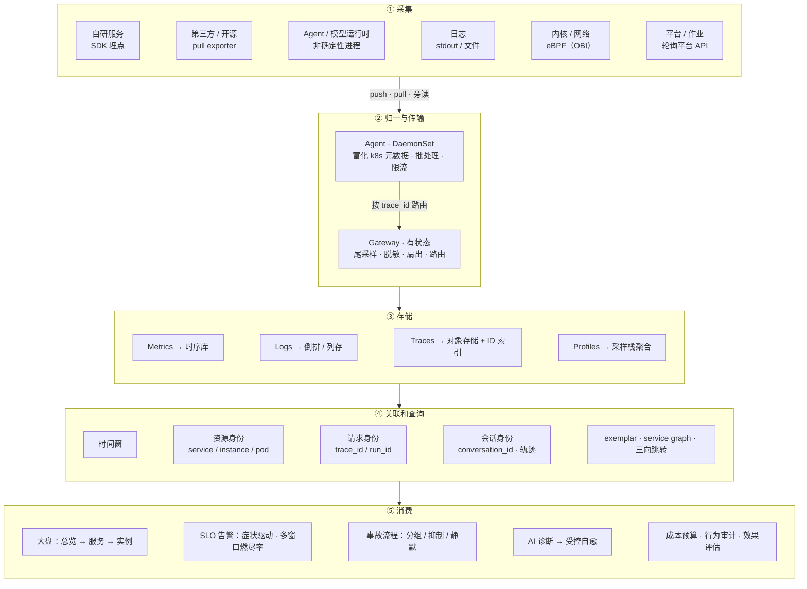

# 可观测洞察

## 1. 可观测技术通用实现

**一张图看全貌**：



### 1.1 关键模块与成熟度

| 段 | 模块 | 标准实现 | 成熟度 | 收敛度 |
| --- | --- | --- | --- | --- |
| **① 采集** | SDK 埋点 | OTel SDK| 高（traces / metrics 稳定 · logs 基本稳定 · profiles experimental） | 收敛 |
| | 语义约定 | OTel semconv | 分域定级（HTTP / DB / RPC / messaging stable · GenAI、CI/CD 仍 experimental / RC） | 分域：其余收敛 · GenAI / CI/CD 发散（新事物） |
| | 三方 exporter | `/metrics` 端点 + Prometheus 文本格式 | 高（事实标准，非 OTel） | 收敛 |
| | 旁读采集 | Fluent Bit / Vector | 高（事实标准强于官方标准） | 收敛 |
| | eBPF | OBI（原 Grafana Beyla） | 中（已并入 OTel） | 收敛 |
| | 平台轮询 | 无 | — | 发散（长尾） |
| **② 归一与传输** | agent · gateway | OpenTelemetry | 高 | 收敛 |
| **③ 存储** | 时序库 | Prometheus 数据模型（Prometheus / VictoriaMetrics / Mimir / Thanos） | 高 | 收敛 |
| | 日志库 | Loki / ES / ClickHouse 三足鼎立 | 高 | 发散（厂商各自下注） |
| | trace 库 | Tempo / Jaeger / ClickHouse 系 | 高 | 收敛 |
| | profile 库 | Pyroscope / Parca | 中 | 未定型 |
| | 统一引擎 | ClickHouse / GreptimeDB / SigNoz | 中，无标准 | 发散（厂商各自下注） |
| **④ 关联和查询** | 关联键 · 时间窗 / 资源身份 / 请求身份 | W3C trace context + OTel resource semconv | 高 | 收敛 |
| | 关联键 · 会话身份（Agent 轨迹） | 无（仅实验性 `gen_ai.conversation.id`） | 低 | 发散（新事物） |
| | exemplar | OpenMetrics | 中（exporter 不支持、采样丢目标、SDK 要手动开） | 收敛 · 落地不全 |
| | service graph / span metrics | Collector connector | 中（只画得出被埋点过的边） | 收敛 |
| | 跳转 UI | 无 | 低（Grafana 靠手配 data link） | 发散（厂商各自下注） |
| **⑤ 消费** | 大盘 | Grafana（事实标准） | 高 | 收敛 |
| | SLO / burn-rate | Google SRE 方法论 + OpenSLO（CNCF sandbox） | 中 | 半收敛 |
| | 分组 / 抑制 / 静默 / 路由 | Alertmanager（事实标准） | 高 | 收敛 |
| | AI 诊断 → 自愈 | 无 | 无 | 发散（厂商各自下注） |
| | 成本预算 · 行为审计 · 效果评估 | 无（Langfuse / Phoenix / LangSmith 各自为政） | 低 | 发散（厂商各自下注） |

**一句话**：发散只有两个来源：**新事物还没有答案**（Ops for AI），**或厂商各自下注**（AIOps）。

## 2. 业界实践

各挑一个代表：开源看 **Grafana Labs** —— 唯一把五段做齐的开源栈；商业看 **Datadog** —— 一体化最完整的一家。

### 2.1 开源阵营：Grafana Labs

一家把五段全做齐了 —— 这在开源里是独一份，所以拿它当代表最合适。

| 段 | 对应产品 | 怎么实现 |
| --- | --- | --- |
| ① 采集 | **Alloy** | 本质是 OpenTelemetry Collector 的发行版。Grafana 把原来的 Promtail、Grafana Agent 全部并入 Alloy（Agent 已停维护），一个 agent 同时采 metrics / logs / traces / profiles。所以开源阵营的采集也是 OTel |
| ② 归一与传输 | **Alloy** | 同一份二进制兼做 agent 和 gateway，靠 OTel pipeline 配置。开源侧没有第二个选择 |
| ③ 存储 | **LGTM + Pyroscope** | Loki（日志）· Grafana（展示）· Tempo（链路）· Mimir（指标），各一套引擎，全部对象存储为底，按信号分开存。这是「拼装」的典型：四种信号四个库 |
| ④ 关联 | **Grafana + 各库自带能力** | exemplar 存进 Mimir、`derivedFields` 从 Loki 日志里抓 `trace_id`、Tempo 的 `metrics-generator` 产出 span metrics 与 service graph —— 每一条关联链路都要人配，配通就是端到端，配不通就是四个孤岛 |
| ⑤ 消费 | **Grafana Alerting · Grafana SLO · OnCall** | 告警在 Grafana 里统一；SLO 和 IRM 是商业版 / Cloud 功能，不开源 |

**要点**：Grafana Labs 是「用开源组件拼出一个产品」的路线。它的开源边界一直推到存储层（LGTM 与 Pyroscope 都开源），所以「自建一套完整可观测」在这条路上是可行的 —— 代价是许可证是 AGPLv3，且要自己运维四套存储。

### 2.2 商业阵营：Datadog

| 段 | 对应产品 | 怎么实现 |
| --- | --- | --- |
| ① 采集 | **单一 dd-agent** | 一个 Agent 出全部信号：指标、日志、APM 链路、Continuous Profiler、进程、还有 eBPF 的 USM。不靠拼，靠一个进程全拿 |
| ② 归一与传输 | **没有独立组件** | 环节本身没省：批处理、打标、聚合在 Agent 侧，过滤、采样、限流在服务端（Ingestion Control）—— 只是没做成可独立部署的 gateway。不设 gateway，因为不打算让你换后端 |
| ③ 存储 | **全部自研** | 指标自研时序库、日志与链路走自研列存 Husky、profile 自研；后来叠加 Flex Logs 这类对象存储冷层。一套体系按信号分层，不是四个库 |
| ④ 关联 | **Related Assets · Service Map · USM** | 不用 exemplar，不用 data link —— 因为指标、日志、链路、profile 本来就躺在同一个后端里，关联是 join 出来的，不是配出来的。服务图由 APM + eBPF 自动生成 |
| ⑤ 消费 | **Monitor · Incident Response · Bits AI** | 告警、值班、事故流程一体；Bits AI（2024 起）做告警摘要与自动调查 |

**要点**：Datadog 走的是「单库贯通」路线。它对「跳转」这件事的解法不是补协议，而是消灭跨库。**五段流程一段没省，只是把相邻环节合并、跨进私有实现** —— 代价是数据形态私有、按主机 / 指标基数 / 日志量 / span 数计费、换不出去。

### 2.3 小结

五段流程（采集 / 归一与传输 / 存储 / 关联和查询 / 消费）是行业共同的标准实现 —— 开源与商业都完整履行，没有一家跳过环节。
差别在环节的边界：开源阵营把每段做成独立可替换的组件，商业阵营把相邻环节合并、跨到私有实现里。
分离部署 = 可换；合并部署 = 一体化 + 锁定。

## 3. 状态页的组件划分

参考 [status.claude.com](https://status.claude.com/)、[githubstatus.com](https://www.githubstatus.com/) 与 [status.deepseek.com](https://status.deepseek.com/)。三站的共同拆法是**横向按用户能感知的功能面切，不按技术栈、也不按内部业务流程纵向切**。层级上只有涉及面广的组件才嵌套：GitHub 全一级；Claude 有 1 个嵌套（Claude on Cloud Platforms）；DeepSeek 有 1 个嵌套（对话服务，含 3 个子组件）。

**总览**：

```
入口       官网
社区自动化  PR / Issue 操作
CI         ├ vllm-ascend · triton · ascend …（按社区嵌套）
社区服务    ├ 软件包仓库 · CVE / 安全公告 · 论坛 · 会议 · 搜索
接入层     CLI
```

### 3.1 组件清单

| # | Component | 涵盖的内容与过程 | 判定信号 |
| --- | --- | --- | --- |
| 1 | **官网** | 页面加载 → 静态资源 / CDN → 登录（OAuth 端到端往返）→ 站内搜索 | 可打开 + 可登录 + 搜索可用；DNS / LB / 证书只做成因 |
| 2 | **PR / Issue 操作** | webhook 接收与验签 → 分发到各机器人 → 调 API 写回（评论 / label / approve / CLA 判定 / check run）→ 读回确认 | 每个「预期写入」在 N 分钟内发生；告警按机器人分，状态页一行 |
| 3 | **CI**（子项按社区：vllm-ascend / triton / ascend / …） | 触发 → runner 分配 → 构建 → 镜像 → 产物上传 / 发布，全链路 | 每个社区单独的 infra failure rate + 排队 P95 + 端到端时长；**子项只列有独立 runner 池或独立受众的社区** |
| 4 | **社区服务**（子项：软件包仓库 / CVE 安全公告 / 论坛 / 会议 / 搜索） | 各子服务自己的同步 / 入库 / 查询 / 下载链路 | 每个子项单独算可用性与**新鲜度**（最近一次同步 / 入库距今）；可用性 + 新鲜度，父状态取最差子项 |
| 5 | **CLI** | 用真实客户端跑一次完整调用：服务发现 → PAT / OAuth 鉴权 → 网关转发 → 后端返回 → 输出；网关限流与配额只做成因 | 端到端调用成功率 + 延迟，**冷缓存与热缓存各一条探针**；成因分解为 discovery 可用性、网关 5xx / 429、token 校验失败率（区分用户 token 错与平台故障） |

**嵌套规则**（CI 与社区服务共用）：

- **嵌套轴 = 用户用来定位自己的维度**。CI 按社区（用户说「我们社区的 CI 挂了」），不按阶段（用户不会说「构建执行层挂了」）。阶段（排队 / 构建 / 制品）是内部流程纵向切，只保留为告警维度与 incident 成因。
- **子项只在降级时展开**（`only_show_if_degraded`），正常情况下只显示父组件一行。
- **父状态取最差子项，不取平均**——一个社区红、其余绿，父组件就是 `partial_outage`。
- **共享依赖故障只报一条**：runner 池、registry、集群、网关出问题时多个子项会同时红，在父级发一条 incident 说明共性成因，不逐条改子项。
- **子项数量控制在 3~6 个**主力社区 / 服务，不要全量铺开，否则一次共享故障会刷出十几行红。

| 子项情况 | 父状态 |
| --- | --- |
| 全部正常 | `operational` |
| 任一子项变慢 / 新鲜度落后但未超阈值 | `degraded_performance` |
| 个别子项不可用，其余正常 | `partial_outage`（incident 正文点名是哪个） |
| 多数子项同时不可用 | `major_outage`（通常是共享依赖故障） |

告警仍按更细的维度报（社区 × 阶段），状态页不展示阶段：状态页一行，告警不合并。

## 4. 观测范围的分层

**原则：自顶向下，L1 为锚点。** L1 承上启下：向上定义用户能走哪些旅程（L0），向下延伸出服务与调用边（L2）、数据与中间件（L3）、云原生基础设施（L4）。每一层只为**解释上一层**而建，不是因为它自己重要；越往下不是越不重要，而是离承诺越远。

| 层 | 回答的问题 | 数据形态 | 典型观测点 | 设 SLO？ |
| --- | --- | --- | --- | --- |
| **L0 端侧旅程** | 用户 / agent 走这条路顺不顺 | 合成探针 / 拨测 / 前端 | 提交 PR → check 出现 → 可合并；点运行 → 结果可见 | 少量（3~5 条旅程） |
| **L1 业务能力** | 我们承诺的能力达标吗 | SLI 指标 | 第 3 章 5 个组件的成功率 / 时延 / 新鲜度 | 每个组件 1 条 |
| **L2 应用与服务** | 哪个服务、哪条调用链坏了 | MELT | 请求成功率、调用边错误率、trace 拓扑 | 不设 |
| **L3 数据与中间件** | 为什么这条请求慢 / 失败 | 指标 + 慢日志 | 慢查询、锁等待、缓存命中率、MQ 积压 | 不设 |
| **L4 云原生与基础设施** | 为什么中间件异常 | 节点 / 网络 / 容器 | 容器重启、OOM、过载、TCP 丢包、DNS 解析异常、磁盘 | 不设 |

### 4.1 三条边界规则

**L0 与 L1 按数据来源分，不按粗细分。** 两者容易混淆，因为「CI 卡顿」既像体验又像指标。分界是：L0 是**跨服务、跨边界、含客户端**的用户旅程，数据只能来自合成探针或前端；L1 是我们单方面可量化的承诺，数据来自平台自己的 SLI。用户说「卡」，对应的是 L1 的排队 P95 高，而 L0 要回答的是「从点运行到看到结果一共多久」。

**层间靠两根绳子连接，否则每层各说各话。** 其一是**关联键**：`request_id` / `trace_id` / `community` / `service`，让同一请求跨层可串。其二是**变更记录**：部署、配置、开关、扩缩容作为横切事件，不塞进任何一层——很多故障不是下层坏了，是上层刚改过。

**SLO 只写 L0 / L1。** L2 以下是诊断指标，给它们设 SLO 等于把内部指标变成对用户的承诺：磁盘用了 80% 不代表用户受影响。

### 4.2 归因方向

**自上而下排除，不是自下而上汇报。** 从 L1 红开始，问 L2「哪条依赖坏了」，再问 L3「哪个中间件」，最后问 L4「哪个节点」。反过来做——底层指标一抖就往上推——就是传统监控：噪声大，且漏掉「机器都好、用户全挂」的故障。

### 4.3 观测点的准入问题

每建一个观测点，回答四个问题：

1. 它对**可理解**有帮助吗？（知道现在是什么状态）
2. 它对**可解释**有帮助吗？（知道为什么）
3. 它对**可行动**有帮助吗？（知道接下来做什么）
4. **谁会看？看完做什么动作？**

四问缺一就放弃。告警额外加一条硬标准：**这条告警响了，值班会做什么？**答不出来就不告警——指标可以留，但不上面板、不进告警、不上状态页。

