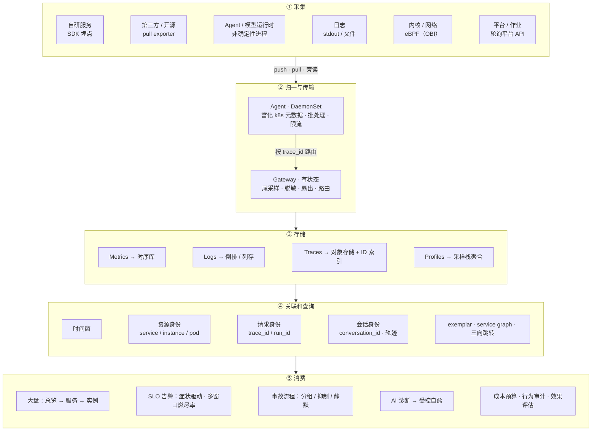

# 可观测洞察

## 1. 可观测技术通用实现

**一张图看全貌**：



### 1.1 关键模块与成熟度

| 段 | 模块 | 标准实现 | 成熟度 | 收敛度 |
| --- | --- | --- | --- | --- |
| **① 采集** | SDK 埋点 | OTel SDK| 高（traces / metrics 稳定 · logs 基本稳定 · profiles experimental） | 收敛 |
| | 语义约定 | OTel semconv | 分域定级（HTTP / DB / RPC / messaging stable · GenAI、CI/CD 仍 experimental / RC） | 分域：其余收敛 · GenAI / CI/CD 发散（新事物） |
| | 三方 exporter | `/metrics` 端点 + Prometheus 文本格式 | 高（事实标准，非 OTel） | 收敛 |
| | 旁读采集 | Fluent Bit / Vector | 高（事实标准强于官方标准） | 收敛 |
| | eBPF | OBI（原 Grafana Beyla） | 中（已并入 OTel） | 收敛 |
| | 平台轮询 | 无 | — | 发散（长尾） |
| **② 归一与传输** | agent · gateway | OpenTelemetry | 高 | 收敛 |
| **③ 存储** | 时序库 | Prometheus 数据模型（Prometheus / VictoriaMetrics / Mimir / Thanos） | 高 | 收敛 |
| | 日志库 | Loki / ES / ClickHouse 三足鼎立 | 高 | 发散（厂商各自下注） |
| | trace 库 | Tempo / Jaeger / ClickHouse 系 | 高 | 收敛 |
| | profile 库 | Pyroscope / Parca | 中 | 未定型 |
| | 统一引擎 | ClickHouse / GreptimeDB / SigNoz | 中，无标准 | 发散（厂商各自下注） |
| **④ 关联和查询** | 关联键 · 时间窗 / 资源身份 / 请求身份 | W3C trace context + OTel resource semconv | 高 | 收敛 |
| | 关联键 · 会话身份（Agent 轨迹） | 无（仅实验性 `gen_ai.conversation.id`） | 低 | 发散（新事物） |
| | exemplar | OpenMetrics | 中（exporter 不支持、采样丢目标、SDK 要手动开） | 收敛 · 落地不全 |
| | service graph / span metrics | Collector connector | 中（只画得出被埋点过的边） | 收敛 |
| | 跳转 UI | 无 | 低（Grafana 靠手配 data link） | 发散（厂商各自下注） |
| **⑤ 消费** | 大盘 | Grafana（事实标准） | 高 | 收敛 |
| | SLO / burn-rate | Google SRE 方法论 + OpenSLO（CNCF sandbox） | 中 | 半收敛 |
| | 分组 / 抑制 / 静默 / 路由 | Alertmanager（事实标准） | 高 | 收敛 |
| | AI 诊断 → 自愈 | 无 | 无 | 发散（厂商各自下注） |
| | 成本预算 · 行为审计 · 效果评估 | 无（Langfuse / Phoenix / LangSmith 各自为政） | 低 | 发散（厂商各自下注） |

**一句话**：发散只有两个来源：**新事物还没有答案**（Ops for AI），**或厂商各自下注**（AIOps）。

## 2. 看自己：基础设施业务的问题盘点

> 看自己分两块：**昇腾 CI**（`ascend-gha-runners/docs` 的 192 个 closed issue）和**社区服务**（`opensourceways/backlog` 的 420 个 `bug` + 各服务仓的 open/closed issue）。

### 2.1 昇腾 CI

#### 2.1.1 按主题盘（标题粗分，可重叠）

| 主题 | 约数 | 代表 issue | 典型根因 |
| --- | --- | --- | --- |
| 调度 / Runner 生命周期 | ~39 | [#309](https://github.com/ascend-gha-runners/docs/issues/309)、[#297](https://github.com/ascend-gha-runners/docs/issues/297)、[#313](https://github.com/ascend-gha-runners/docs/issues/313)、[#53](https://github.com/ascend-gha-runners/docs/issues/53) | Karpenter drift、CCE 缩容、EphemeralRunner 残留、Pod Pending/ContainerCreating、排队 |
| 依赖 / 缓存 / 网络 | ~53 | [#341](https://github.com/ascend-gha-runners/docs/issues/341)、[#339](https://github.com/ascend-gha-runners/docs/issues/339)、[#305](https://github.com/ascend-gha-runners/docs/issues/305)、[#304](https://github.com/ascend-gha-runners/docs/issues/304) | NFS 文件锁、Squid liveness 误杀、gitcode pack 截断、nginx-pypi 回源超时、SWR 503、证书过期、带宽打满 |
| 配置 / 模板 / 升级 / 标签 | ~25 | [#313](https://github.com/ascend-gha-runners/docs/issues/313)、[#307](https://github.com/ascend-gha-runners/docs/issues/307)、[#306](https://github.com/ascend-gha-runners/docs/issues/306)、[#332](https://github.com/ascend-gha-runners/docs/issues/332) | 旧标签清理误删 ConfigMap、postStart 写未挂载目录、estimated_times 未登记、workflow pin 已下线 wheel |
| NPU / 硬件 / 驱动 | ~21 | [#337](https://github.com/ascend-gha-runners/docs/issues/337)、[#152](https://github.com/ascend-gha-runners/docs/issues/152)、[#233](https://github.com/ascend-gha-runners/docs/issues/233)、[#318](https://github.com/ascend-gha-runners/docs/issues/318) | 卡数口径不一致、310P ACLGraph hang、节点掉卡、A3 TransData 无 kernel、dcmi 初始化失败、device 被占用 |
| 磁盘 / 配额 / OOM | ~13 | [#324](https://github.com/ascend-gha-runners/docs/issues/324)、[#252](https://github.com/ascend-gha-runners/docs/issues/252)、[#221](https://github.com/ascend-gha-runners/docs/issues/221)、[#191](https://github.com/ascend-gha-runners/docs/issues/191) | 可写层 100GiB 配额、buildkit 空间不足、共享盘占满、ModelScope 写缓存超配额 |
| 业务反馈（用户报） | ~38 | [#332](https://github.com/ascend-gha-runners/docs/issues/332)、[#324](https://github.com/ascend-gha-runners/docs/issues/324)、[#306](https://github.com/ascend-gha-runners/docs/issues/306)、[#298](https://github.com/ascend-gha-runners/docs/issues/298) | 大量“PR/Nightly 出现问题”，很多没有内部告警 |
| 安全事件 | 1 | [#302](https://github.com/ascend-gha-runners/docs/issues/302) | A5 机器被攻击导致共享盘不可用 |
| 需求 / 接入 / 优化 | ~30 | [#94](https://github.com/ascend-gha-runners/docs/issues/94)、[#76](https://github.com/ascend-gha-runners/docs/issues/76)、[#73](https://github.com/ascend-gha-runners/docs/issues/73) | A3 共池、接入新集群、排队时长周报、缓存加速 |

#### 2.1.2 按业务块映射

| 业务块 | 对应问题 |
| --- | --- |
| CI/CD 与构建 | 调度、runner、checkout、依赖安装、buildkit、workflow pin、estimated_times、ci-gate |
| 集群与算力 | Karpenter/CCE、节点掉卡、NPU 卡数/健康、磁盘、内存、ARC 升级 |
| 依赖与制品 | NFS、Squid、git-cdn、smart-git-proxy、nginx-pypi、SWR、镜像拉取、带宽 |
| 网络与入口 | EIP/NAT、防火墙白名单、证书、DNS、GitHub/GitCode 上游、503/504/413 |
| 服务与发布底座 | ConfigMap 误删、标签清理、ARC/runner image 升级、automount |

> 口径：标题关键词粗分，一个 issue 可命中多个主题；“中位关闭耗时”是 created → closed，包含等业务确认/排期，**不等于 MTTR**。

**按业务块的故障数与主动发现率**

| 业务块 | 故障数 | 主动监控 | 非主动（用户反馈等） | 主动发现率 | 平均 | p50 | p90 | 最长 |
| --- | --- | --- | --- | --- | --- | --- | --- | --- |
| CI/CD 与构建 | 72 | 5 | 67 | 7% | 738h | 287h | 1320h | 9400h |
| 集群与算力 | 31 | 0 | 31 | 0% | 674h | 287h | 1666h | 2676h |
| 依赖与制品 | 30 | 0 | 30 | 0% | 850h | 134h | 3005h | 4714h |
| 网络与入口 | 12 | 0 | 12 | 0% | 868h | 421h | 1390h | 3596h |
| 服务与发布底座 | 10 | 0 | 10 | 0% | 1272h | 68h | 2651h | 6887h |
| 未分类 | 7 | 0 | 7 | 0% | 192h | 1h | 504h | 555h |
| **合计** | **162** | **5** | **157** | **3%** | **766h** | **270h** | **1901h** | **9400h** |

> 口径：192 个 closed issue 中排除 30 个需求/任务/测试单，剩 **162 个故障 issue**；一个 issue 只归一个主块。“主动监控”只统计标题/正文明确由系统发现的 **#90–#94**（均为 2025-04 排队时长周报；#94 是“关注”不是“异常”），其余全部计入“非主动（用户反馈等）”。时间为 created → closed，是**关单耗时**，**不等于 MTTR**。

#### 2.1.3 五个关键结论

**1. 大量问题靠“业务反馈”发现**

- 38 个标题明确写“业务反馈”，还有不少“PR/Nightly 出现问题”的模糊标题，大概率也是用户先发现。
- **说明**：内部检测不足，用户是主要探测器——这是可观测最大的缺口。

**明确内部主动发现：周报指标（5 个）**

| Issue | 证据 |
| --- | --- |
| [#90](https://github.com/ascend-gha-runners/docs/issues/90) | `[周报指标异常]: verl CI 排队时长超标` — “周报统计” |
| [#91](https://github.com/ascend-gha-runners/docs/issues/91) | `[周报指标异常]: sglang CI 排队时长超标` — “周报统计” |
| [#92](https://github.com/ascend-gha-runners/docs/issues/92) | `[周报指标异常]: triton-ascend CI 排队时长超标` — “周报统计” |
| [#93](https://github.com/ascend-gha-runners/docs/issues/93) | `[周报指标异常]: tilelang-ascend CI 排队时长超标` — “周报统计” |
| [#94](https://github.com/ascend-gha-runners/docs/issues/94) | `[周报指标关注]: vllm-ascend CI 排队时长偏高` — “周报统计” |

这 5 个是指标驱动的，不依赖用户报障。

**内部发现，但靠 CI 红 / 事后排查**

| Issue | 发现方式 | 正文证据 |
| --- | --- | --- |
| [#339](https://github.com/ascend-gha-runners/docs/issues/339) | CI 大面积红 | “只有 CI 大面积红才发现” |
| [#313](https://github.com/ascend-gha-runners/docs/issues/313) | 事后排查 | “pod 静默卡 ContainerCreating 5 天无人知” |
| [#341](https://github.com/ascend-gha-runners/docs/issues/341) | 事后排查 | “从 03:57 UTC 首次失败到定位，集群侧零告警” |
| [#226](https://github.com/ascend-gha-runners/docs/issues/226) | CI 失败后 2 小时 | “从 01:33 拉黑到发现隔了约 2 小时”“无扩容量告警” |
| [#304](https://github.com/ascend-gha-runners/docs/issues/304) | CI 失败 + 排查 | “目前仅 squid 账本可见、无告警” |
| [#305](https://github.com/ascend-gha-runners/docs/issues/305) | 与 [#304](https://github.com/ascend-gha-runners/docs/issues/304) 同期排查 | “建议对该容器加 restarts 告警” |
| [#309](https://github.com/ascend-gha-runners/docs/issues/309) | 事后排查 | “建议对 `Disrupting Node: Drifted` 做告警” |
| [#225](https://github.com/ascend-gha-runners/docs/issues/225) | 事后排查 | “排查结论：不是泄漏、不是调度 bug，是带外容器” |
| [#53](https://github.com/ascend-gha-runners/docs/issues/53) | 事后排查 | “本 issue 提出时即发现该问题” |
| [#152](https://github.com/ascend-gha-runners/docs/issues/152) | 事后排查 | 根因分析 + 联系华为/云平台 |
| [#308](https://github.com/ascend-gha-runners/docs/issues/308) | 两波复盘 | “原始排查记录保留在评论区” |
| [#234](https://github.com/ascend-gha-runners/docs/issues/234) | 根因分析 | “根因分析” |
| [#148](https://github.com/ascend-gha-runners/docs/issues/148) | 事后排查 | “已排查情况” |
| [#187](https://github.com/ascend-gha-runners/docs/issues/187) | 事后排查 | FileBaton 锁残留 |
| [#228](https://github.com/ascend-gha-runners/docs/issues/228) | nightly 复盘 | “中途杀死却显示 success” |
| [#318](https://github.com/ascend-gha-runners/docs/issues/318) | Nightly 红 | 23/25 job 全红 |
| [#322](https://github.com/ascend-gha-runners/docs/issues/322) | Nightly 结果异常 | 性能/精度与落点机器强相关 |
| [#282](https://github.com/ascend-gha-runners/docs/issues/282) | CI 连续 503 | “E2E Recommend-tests 连续 4 次 503” |

这些是“基础设施自己处理的”，但发现方式是 CI 红或事后排查，不是主动告警/巡检。

**看似内部，实为业务触发或复盘**

| Issue | 实际触发 |
| --- | --- |
| [#331](https://github.com/ascend-gha-runners/docs/issues/331) | **业务反馈触发**：“登记并关联 [#328](https://github.com/ascend-gha-runners/docs/issues/328)：2026-11-05 业务反馈 vllm-ascend CI checkout 耗时…” |
| [#334](https://github.com/ascend-gha-runners/docs/issues/334) | **事故复盘**：“cert-expiry 巡检未覆盖 SWR 域名”“告警规则缺失” — 是巡检缺口，不是巡检发现 |
| [#304](https://github.com/ascend-gha-runners/docs/issues/304) | CI 失败 + 排查，不是上游探针发现 |
| [#305](https://github.com/ascend-gha-runners/docs/issues/305) | 与 [#304](https://github.com/ascend-gha-runners/docs/issues/304) 同期发现，不是独立告警 |

**2. 关闭耗时长，但“检测慢”和“修复慢”要分开**

- 中位数 **12 天**关闭；
- 只有 **20%** 在 1 天内关闭；
- 很多 issue 是“已止血/已回退/等业务确认”，不是技术修复慢。
- **建议**：故障清单里分开记“检测耗时 / 定位耗时 / 修复耗时”。

关闭耗时（created → closed，粗略当 MTTR 代理）：

| 指标 | 数值 |
| --- | --- |
| 中位数 | ~290 小时（约 12 天） |
| 平均 | ~1080 小时（约 45 天） |
| ≤1 天关闭 | 38 个（20%） |
| ≤3 天 | 56 个（29%） |
| ≤7 天 | 74 个（39%） |
| ≤30 天 | 131 个（68%） |

注意：这是“关闭耗时”，包含等业务确认、等排期，不等于 MTTR；但能说明大量问题不是当天能闭环。

**3. 变更引发的故障占比高**

- 旧标签清理误删 ConfigMap（[#313](https://github.com/ascend-gha-runners/docs/issues/313)）；
- workflow pin 已下线 wheel（[#332](https://github.com/ascend-gha-runners/docs/issues/332)）；
- ARC/runner image 升级不兼容（[#42](https://github.com/ascend-gha-runners/docs/issues/42)、[#61](https://github.com/ascend-gha-runners/docs/issues/61)、[#116](https://github.com/ascend-gha-runners/docs/issues/116)）；
- postStart 写未挂载目录（[#307](https://github.com/ascend-gha-runners/docs/issues/307)）；
- estimated_times 未登记（[#306](https://github.com/ascend-gha-runners/docs/issues/306)）。
- **说明**：变更观测 / CI gate 不足，不是“运行时不稳”。

**4. 上游和网络是主要外因**

- GitHub `.diff` 503（[#282](https://github.com/ascend-gha-runners/docs/issues/282)）；
- gitcode pack 截断（[#304](https://github.com/ascend-gha-runners/docs/issues/304)）；
- 华为云镜像限速（[#115](https://github.com/ascend-gha-runners/docs/issues/115)）；
- SWR 证书过期（[#334](https://github.com/ascend-gha-runners/docs/issues/334)）；
- 防火墙白名单缺端口（[#285](https://github.com/ascend-gha-runners/docs/issues/285)）；
- 带宽打满（[#210](https://github.com/ascend-gha-runners/docs/issues/210)、[#163](https://github.com/ascend-gha-runners/docs/issues/163)）。
- **说明**：Egress / 上游探针必须单独建。

**5. 调度与资源生命周期是最大内因**

- Karpenter drift 驱逐（[#309](https://github.com/ascend-gha-runners/docs/issues/309)、[#186](https://github.com/ascend-gha-runners/docs/issues/186)）；
- CCE 缩容（[#297](https://github.com/ascend-gha-runners/docs/issues/297)、[#185](https://github.com/ascend-gha-runners/docs/issues/185)）；
- EphemeralRunner 残留（[#53](https://github.com/ascend-gha-runners/docs/issues/53)、[#39](https://github.com/ascend-gha-runners/docs/issues/39)）；
- 排队过长（[#94](https://github.com/ascend-gha-runners/docs/issues/94)、[#206](https://github.com/ascend-gha-runners/docs/issues/206)、[#212](https://github.com/ascend-gha-runners/docs/issues/212)）；
- Pod 卡 Pending/ContainerCreating/PodInitializing（[#313](https://github.com/ascend-gha-runners/docs/issues/313)、[#308](https://github.com/ascend-gha-runners/docs/issues/308)）。
- **说明**：Runner/Job 生命周期是最该先补的观测面。

### 2.2 社区服务

> 数据源：`opensourceways/backlog` 的 `bug` issue（CVE/安全整改单不纳入故障梳理）+ 各社区服务仓的 issue（open + closed）：`om-webserver`、`app-cla-server`、`cve-manager-ng`、`openeuler-easysearch`、`robot-*`。

#### 2.2.1 backlog 整体 bug：主题分布

| 主题 | 约数 | 说明 |
| --- | --- | --- |
| om-datacenter | 81 | 数据中台相关缺陷 |
| CI / 构建 | 31 | CI 信息采集、看板接口慢、引包流程 |
| CLA | 12 | 超级管理员身份重复、企业 CLA 审批、子域名排他、员工签署 |
| 机器人 | 12 | label/review 升级、敏感信息、同步机器人名称 |
| 软件包 / 制品 | 11 | repo_branch_task 全量采集慢、私有仓 sig 配置、ROS 引包 |
| 登录 / 认证 / OIDC | 8 | OKTA、验证码、token 刷新 OOM、统一认证权限 |
| 部署 / 配置 | 12 | 配置路径、ArgoCD 资源抢占、拨测误报 |
| 权限 / RBAC | 5 | 凭证权限不足、runner 注册失败 |
| 会议 / 邮件 / 搜索 | 各 1–3 | 会议 token、邮箱采集 404、psycopg2 dict |

**结论**：排除 CVE/安全整改单后，backlog 的 bug 主要是**平台项目缺陷**（om-datacenter、CI、CLA、机器人、软件包等），不是社区服务运行时故障。

#### 2.2.2 社区服务按仓

> 口径：只算**功能缺陷**（`bug` 标签或 `[缺陷]/[Bug]` 标题），排除 CVE/安全整改、任务/需求/Feature、test/验证/chore；机器人仓合并为一行。

| 服务 | 故障数 | 主动发现率 | 主要问题 | 占比 | 代表 issue |
| --- | --- | --- | --- | --- | --- |
| **账号** `om-webserver` | 6 | **0%** | OIDC 刷新 token JWT 过期未更新、passkey 列表查不到、Authing 接口切换、错误消息占位符未替换、Workflow Validation 404、IP 审计记录错误 | 21% | [#285](https://github.com/opensourceways/om-webserver/issues/285)、[#277](https://github.com/opensourceways/om-webserver/issues/277)、[#275](https://github.com/opensourceways/om-webserver/issues/275)、[#263](https://github.com/opensourceways/om-webserver/issues/263)、[#250](https://github.com/opensourceways/om-webserver/issues/250)、[#186](https://github.com/opensourceways/om-webserver/issues/186) |
| **CLA** `app-cla-server` | 1 | **0%** | 无法提交 CLA、页面无工作人员支持；其余为 idea/feature，未计入 | 3% | [#139](https://github.com/opensourceways/app-cla-server/issues/139) |
| **CVE 管理** `cve-manager-ng` | 6 | **0%** | 版本匹配、trivy 扫 Java 访问 Maven 429、组织仓库列表异常、标签/责任人、私密 issue event type、社区自定义字段 | 21% | [#113](https://github.com/opensourceways/cve-manager-ng/issues/113)、[#105](https://github.com/opensourceways/cve-manager-ng/issues/105)、[#94](https://github.com/opensourceways/cve-manager-ng/issues/94)、[#91](https://github.com/opensourceways/cve-manager-ng/issues/91)、[#85](https://github.com/opensourceways/cve-manager-ng/issues/85)、[#79](https://github.com/opensourceways/cve-manager-ng/issues/79) |
| **搜索** `openeuler-easysearch` | 0 | **0%** | 本批只有 CVE 和任务，没有功能缺陷 | 0% | —（#21 是任务，#22 是 CVE） |
| **机器人**（`robot-*` 合并） | 16 | **0%** | label 权限/通配符/事件触发、review codeowner/AI/lgtm、access 私密 issue webhook、associate issue_state、assign 看板默认、repo-watcher 重命名/门禁、CLA 评论合并、hook-delivery CodeArts | 55% | [#55](https://github.com/opensourceways/robot-universal-label/issues/55)、[#52](https://github.com/opensourceways/robot-universal-label/issues/52)、[#76](https://github.com/opensourceways/robot-universal-review/issues/76)、[#69](https://github.com/opensourceways/robot-universal-review/issues/69)、[#56](https://github.com/opensourceways/robot-universal-access/issues/56)、[#8](https://github.com/opensourceways/robot-universal-associate/issues/8)、[#16](https://github.com/opensourceways/robot-universal-assign/issues/16)、[#23](https://github.com/opensourceways/robot-universal-repo-watcher/issues/23)、[#36](https://github.com/opensourceways/robot-universal-cla/issues/36)、[#7](https://github.com/opensourceways/robot-universal-hook-delivery/issues/7) |
| **合计** | **29** | **0%** | — | **100%** | — |

> 说明：**0% = 没有明确“系统主动发现”的证据**，不等于完全没有监控；社区服务 issue 里没有告警/探针/巡检/周报记录，基本都是用户、维护者或 CI 红之后才发现。机器人仓的 CVE 单、任务单已排除。

#### 2.2.3 跨服务结论

1. **功能 bug 集中在四类**：
   - 认证/账号（OIDC、passkey、Authing）；
   - CLA（提交、审批、记录、评论合并）；
   - 机器人权限/逻辑（label、review、access、associate、assign）；
   - 服务自身逻辑（版本匹配、第三方接口 429、搜索 apppkg）；
2. **社区服务与 CI 的问题类型完全不同**：CI 是调度/NPU/依赖，社区服务是**业务逻辑、权限、认证**；
3. **社区服务几乎没有运行时观测**：问题主要靠 issue 和用户反馈，不是告警/探针；
4. **issue 计数不能直接当故障频率**：机器人仓的 issue 大量是 task/升级单，需过滤后再统计。

## 3. 业界实践

各挑一个代表：开源看 **Grafana Labs** —— 唯一把五段做齐的开源栈；商业看 **Datadog** —— 一体化最完整的一家。

### 3.1 开源阵营：Grafana Labs

一家把五段全做齐了 —— 这在开源里是独一份，所以拿它当代表最合适。

| 段 | 对应产品 | 怎么实现 |
| --- | --- | --- |
| ① 采集 | **Alloy** | 本质是 OpenTelemetry Collector 的发行版。Grafana 把原来的 Promtail、Grafana Agent 全部并入 Alloy（Agent 已停维护），一个 agent 同时采 metrics / logs / traces / profiles。所以开源阵营的采集也是 OTel |
| ② 归一与传输 | **Alloy** | 同一份二进制兼做 agent 和 gateway，靠 OTel pipeline 配置。开源侧没有第二个选择 |
| ③ 存储 | **LGTM + Pyroscope** | Loki（日志）· Grafana（展示）· Tempo（链路）· Mimir（指标），各一套引擎，全部对象存储为底，按信号分开存。这是「拼装」的典型：四种信号四个库 |
| ④ 关联 | **Grafana + 各库自带能力** | exemplar 存进 Mimir、`derivedFields` 从 Loki 日志里抓 `trace_id`、Tempo 的 `metrics-generator` 产出 span metrics 与 service graph —— 每一条关联链路都要人配，配通就是端到端，配不通就是四个孤岛 |
| ⑤ 消费 | **Grafana Alerting · Grafana SLO · OnCall** | 告警在 Grafana 里统一；SLO 和 IRM 是商业版 / Cloud 功能，不开源 |

**要点**：Grafana Labs 是「用开源组件拼出一个产品」的路线。它的开源边界一直推到存储层（LGTM 与 Pyroscope 都开源），所以「自建一套完整可观测」在这条路上是可行的 —— 代价是许可证是 AGPLv3，且要自己运维四套存储。

### 3.2 商业阵营：Datadog

| 段 | 对应产品 | 怎么实现 |
| --- | --- | --- |
| ① 采集 | **单一 dd-agent** | 一个 Agent 出全部信号：指标、日志、APM 链路、Continuous Profiler、进程、还有 eBPF 的 USM。不靠拼，靠一个进程全拿 |
| ② 归一与传输 | **没有独立组件** | 环节本身没省：批处理、打标、聚合在 Agent 侧，过滤、采样、限流在服务端（Ingestion Control）—— 只是没做成可独立部署的 gateway。不设 gateway，因为不打算让你换后端 |
| ③ 存储 | **全部自研** | 指标自研时序库、日志与链路走自研列存 Husky、profile 自研；后来叠加 Flex Logs 这类对象存储冷层。一套体系按信号分层，不是四个库 |
| ④ 关联 | **Related Assets · Service Map · USM** | 不用 exemplar，不用 data link —— 因为指标、日志、链路、profile 本来就躺在同一个后端里，关联是 join 出来的，不是配出来的。服务图由 APM + eBPF 自动生成 |
| ⑤ 消费 | **Monitor · Incident Response · Bits AI** | 告警、值班、事故流程一体；Bits AI（2024 起）做告警摘要与自动调查 |

**要点**：Datadog 走的是「单库贯通」路线。它对「跳转」这件事的解法不是补协议，而是消灭跨库。**五段流程一段没省，只是把相邻环节合并、跨进私有实现** —— 代价是数据形态私有、按主机 / 指标基数 / 日志量 / span 数计费、换不出去。

### 3.3 小结

五段流程（采集 / 归一与传输 / 存储 / 关联和查询 / 消费）是行业共同的标准实现 —— 开源与商业都完整履行，没有一家跳过环节。
差别在环节的边界：开源阵营把每段做成独立可替换的组件，商业阵营把相邻环节合并、跨到私有实现里。
分离部署 = 可换；合并部署 = 一体化 + 锁定。

## 4. 状态页的组件划分

参考 [status.claude.com](https://status.claude.com/)、[githubstatus.com](https://www.githubstatus.com/) 与 [status.deepseek.com](https://status.deepseek.com/)。三站的共同拆法是**横向按用户能感知的功能面切，不按技术栈、也不按内部业务流程纵向切**。层级上只有涉及面广的组件才嵌套：GitHub 全一级；Claude 有 1 个嵌套（Claude on Cloud Platforms）；DeepSeek 有 1 个嵌套（对话服务，含 3 个子组件）。

**总览**：

```
入口       官网
社区自动化  PR / Issue 操作
CI         ├ vllm-ascend · triton · ascend …（按社区嵌套）
社区服务    ├ 软件包仓库 · CVE / 安全公告 · 论坛 · 会议 · 搜索
接入层     CLI
```

### 4.1 组件清单

| # | Component | 涵盖的内容与过程 | 判定信号 |
| --- | --- | --- | --- |
| 1 | **官网** | 页面加载 → 静态资源 / CDN → 登录（OAuth 端到端往返）→ 站内搜索 | 可打开 + 可登录 + 搜索可用；DNS / LB / 证书只做成因 |
| 2 | **PR / Issue 操作** | webhook 接收与验签 → 分发到各机器人 → 调 API 写回（评论 / label / approve / CLA 判定 / check run）→ 读回确认 | 每个「预期写入」在 N 分钟内发生；告警按机器人分，状态页一行 |
| 3 | **CI**（子项按社区：vllm-ascend / triton / ascend / …） | 触发 → runner 分配 → 构建 → 镜像 → 产物上传 / 发布，全链路 | 每个社区单独的 infra failure rate + 排队 P95 + 端到端时长；**子项只列有独立 runner 池或独立受众的社区** |
| 4 | **社区服务**（子项：软件包仓库 / CVE 安全公告 / 论坛 / 会议 / 搜索） | 各子服务自己的同步 / 入库 / 查询 / 下载链路 | 每个子项单独算可用性与**新鲜度**（最近一次同步 / 入库距今）；可用性 + 新鲜度，父状态取最差子项 |
| 5 | **CLI** | 用真实客户端跑一次完整调用：服务发现 → PAT / OAuth 鉴权 → 网关转发 → 后端返回 → 输出；网关限流与配额只做成因 | 端到端调用成功率 + 延迟，**冷缓存与热缓存各一条探针**；成因分解为 discovery 可用性、网关 5xx / 429、token 校验失败率（区分用户 token 错与平台故障） |

**嵌套规则**（CI 与社区服务共用）：

- **嵌套轴 = 用户用来定位自己的维度**。CI 按社区（用户说「我们社区的 CI 挂了」），不按阶段（用户不会说「构建执行层挂了」）。阶段（排队 / 构建 / 制品）是内部流程纵向切，只保留为告警维度与 incident 成因。
- **子项只在降级时展开**（`only_show_if_degraded`），正常情况下只显示父组件一行。
- **父状态取最差子项，不取平均**——一个社区红、其余绿，父组件就是 `partial_outage`。
- **共享依赖故障只报一条**：runner 池、registry、集群、网关出问题时多个子项会同时红，在父级发一条 incident 说明共性成因，不逐条改子项。
- **子项数量控制在 3~6 个**主力社区 / 服务，不要全量铺开，否则一次共享故障会刷出十几行红。

| 子项情况 | 父状态 |
| --- | --- |
| 全部正常 | `operational` |
| 任一子项变慢 / 新鲜度落后但未超阈值 | `degraded_performance` |
| 个别子项不可用，其余正常 | `partial_outage`（incident 正文点名是哪个） |
| 多数子项同时不可用 | `major_outage`（通常是共享依赖故障） |

告警仍按更细的维度报（社区 × 阶段），状态页不展示阶段：状态页一行，告警不合并。

## 5. 观测范围的分层

**原则：自顶向下，L1 为锚点。** L1 承上启下：向上定义用户能走哪些旅程（L0），向下延伸出服务与调用边（L2）、数据与中间件（L3）、云原生基础设施（L4）。每一层只为**解释上一层**而建，不是因为它自己重要；越往下不是越不重要，而是离承诺越远。

| 层 | 回答的问题 | 数据形态 | 典型观测点 | 设 SLO？ |
| --- | --- | --- | --- | --- |
| **L0 端侧旅程** | 用户 / agent 走这条路顺不顺 | 合成探针 / 拨测 / 前端 | 提交 PR → check 出现 → 可合并；点运行 → 结果可见 | 少量（3~5 条旅程） |
| **L1 业务能力** | 我们承诺的能力达标吗 | SLI 指标 | 第 4 章 5 个组件的成功率 / 时延 / 新鲜度 | 每个组件 1 条 |
| **L2 应用与服务** | 哪个服务、哪条调用链坏了 | MELT | 请求成功率、调用边错误率、trace 拓扑 | 不设 |
| **L3 数据与中间件** | 为什么这条请求慢 / 失败 | 指标 + 慢日志 | 慢查询、锁等待、缓存命中率、MQ 积压 | 不设 |
| **L4 云原生与基础设施** | 为什么中间件异常 | 节点 / 网络 / 容器 | 容器重启、OOM、过载、TCP 丢包、DNS 解析异常、磁盘 | 不设 |

### 5.1 三条边界规则

**L0 与 L1 按数据来源分，不按粗细分。** 两者容易混淆，因为「CI 卡顿」既像体验又像指标。分界是：L0 是**跨服务、跨边界、含客户端**的用户旅程，数据只能来自合成探针或前端；L1 是我们单方面可量化的承诺，数据来自平台自己的 SLI。用户说「卡」，对应的是 L1 的排队 P95 高，而 L0 要回答的是「从点运行到看到结果一共多久」。

**层间靠两根绳子连接，否则每层各说各话。** 其一是**关联键**：`request_id` / `trace_id` / `community` / `service`，让同一请求跨层可串。其二是**变更记录**：部署、配置、开关、扩缩容作为横切事件，不塞进任何一层——很多故障不是下层坏了，是上层刚改过。

**SLO 只写 L0 / L1。** L2 以下是诊断指标，给它们设 SLO 等于把内部指标变成对用户的承诺：磁盘用了 80% 不代表用户受影响。

### 5.2 归因方向

**自上而下排除，不是自下而上汇报。** 从 L1 红开始，问 L2「哪条依赖坏了」，再问 L3「哪个中间件」，最后问 L4「哪个节点」。反过来做——底层指标一抖就往上推——就是传统监控：噪声大，且漏掉「机器都好、用户全挂」的故障。

### 5.3 观测点的准入问题

每建一个观测点，回答四个问题：

1. 它对**可理解**有帮助吗？（知道现在是什么状态）
2. 它对**可解释**有帮助吗？（知道为什么）
3. 它对**可行动**有帮助吗？（知道接下来做什么）
4. **谁会看？看完做什么动作？**

四问缺一就放弃。告警额外加一条硬标准：**这条告警响了，值班会做什么？**答不出来就不告警——指标可以留，但不上面板、不进告警、不上状态页。

